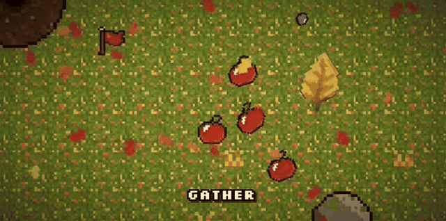
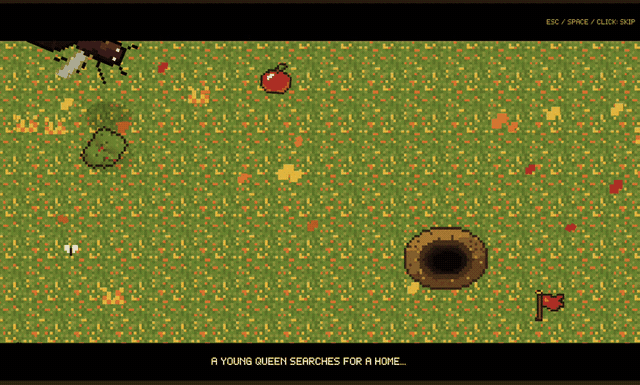
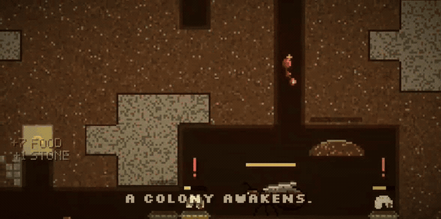
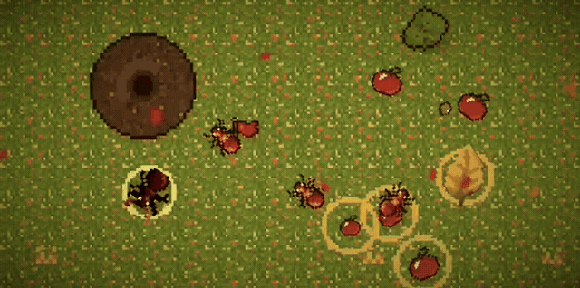
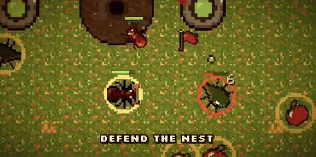
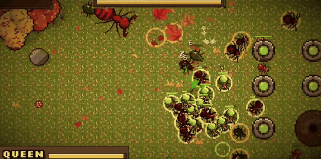

<div align="center">

# 👑 Queen's Colony

**A pixel-art ant colony defence game made in Unity**

🥈 **2nd place, CClub Game Hackathon '26**



</div>

---

Run an ant colony through the fall. Gather food on the meadow, dig out the nest, raise new ants, and protect the queen
through **10 waves of bugs** and a **final boss**.

## Features

- **Two worlds, one colony.** Switch between the meadow on the surface and the nest underground with a single key.
- **Raise your army.** Workers gather food, builders dig and build, soldiers fight, and acid spitters attack from range.
- **Build the nest.** Dig tunnels and add storage, cradles for larvae, and fungus gardens.
- **Defend the surface.** Put up walls and acid towers, then command your soldiers RTS-style.
- **10 waves and a boss.** Call waves early if you're feeling brave, then check the wave report to see what went wrong.
- **Opening story.** A short cutscene of the queen founding her colony.
- **Guided tutorial** that waits for you to finish each step before moving on.
- **In-game music player** with a playlist and your ants wearing headphones.
- **English and Turkish (Türkçe)** with autosave after every wave.

## Gameplay

| A young queen searches for a home | A colony awakens |
|---|---|
|  |  |

| Autumn, the forest floor | Defend the nest |
|---|---|
|  |  |

<div align="center">

**The final boss**



</div>

## Play it

### Download a build

Grab the latest **Windows** or **Linux** build from the [Releases](https://github.com/ebuzerdrmz44/cclub-game-hackathon-26/releases) page,
extract it, and run `QueensColony.exe` (Windows) or `QueensColony.x86_64` (Linux).

### Run from source

You need **Unity Hub** and the Unity editor **6000.3.25f1** (Unity 6.3). Unity Hub offers to install the exact version when you open the project.

1. Clone the repo:
   ```bash
   git clone https://github.com/ebuzerdrmz44/cclub-game-hackathon-26.git
   ```
2. In **Unity Hub**, choose **Add** → **Add project from disk** and pick the cloned folder.
   The first import takes a few minutes.
3. Open the scene **`Assets/_Project/Scenes/AntColony.unity`** and press **Play** ▶.

Set the **Game** view to **Full HD (1920x1080)** or **16:9** to see the HUD as intended.

To make your own build, open **File → Build Profiles**, pick your platform, check that `AntColony.unity` is first in the
scene list, and press **Build**.

## How to play

New players should start with **Tutorial** from the main menu. Waves pause until the tutorial is finished, and you get at
least 45 seconds to prepare after it.

### Controls

| Key | Action |
|---|---|
| WASD / arrows, mouse wheel | Move / zoom the camera |
| Tab | Switch between the meadow and the nest |
| 1 / 2 / 3 / Z | Raise a worker / soldier / builder / acid spitter |
| M | Missions (jobs for workers and builders) |
| R | Colony report |
| H | Controls |
| N | Call the next wave early |
| Esc | Put a tool down, close a panel, or pause |
| F5 / F9 | Save / load |

**On the surface:** `4` walls, `5` acid towers, `6` gather (pick which food piles workers fetch).
Drag a box to select soldiers, right-click to move or attack, `E` selects all soldiers, `Q` halves the group.

**In the nest:** `4` dig, `5` storage, `6` cradle, `7` fungus garden, `X` remove.

### Good to know

- Click the **wave banner** at the top to open the wave report, which shows kills, losses and what killed your ants in every wave so far.
- The **music note** in the top-right opens the music player. **Wave music** can be toggled there.
- **Settings** (title or pause menu) has sound, language, and **Autosave after waves** (on by default).
- Autosave, F5 and F9 share one save slot. A backup of the previous save is kept as `colony-save.json.bak`.

## Team

- [Ebuzer Celil Durmaz](https://github.com/ebuzerdrmz44)
- [Furkan Mutlu](https://github.com/fmutlu68)

## For developers

- Code is in `Assets/_Project/Scripts`, art in `Assets/_Project/Art`, prefabs in `Assets/_Project/Prefabs`.
- Most tuning (costs, speeds, waves, the boss, audio, UI images, effect prefabs) lives on the **Colony Game** object in
  the scene Inspector. More details are in [`Assets/_Project/README.md`](Assets/_Project/README.md).
- Translations live in `Assets/_Project/Scripts/Core/Localization.Turkish.cs`, keyed by the exact English text.
  Texts with numbers use `Loc.F("Wave {0} is coming!", wave)`. Missing translations fall back to English.
- Music player portraits live in `Assets/_Project/Art/UI/MusicPortraits`. Each UI Skin portrait has an optional
  `musicImage`; if it's empty, the player uses the original portrait.
- In the editor, **F8** during Play jumps to a test of the final boss wave (and saves it, so F9 replays it).
